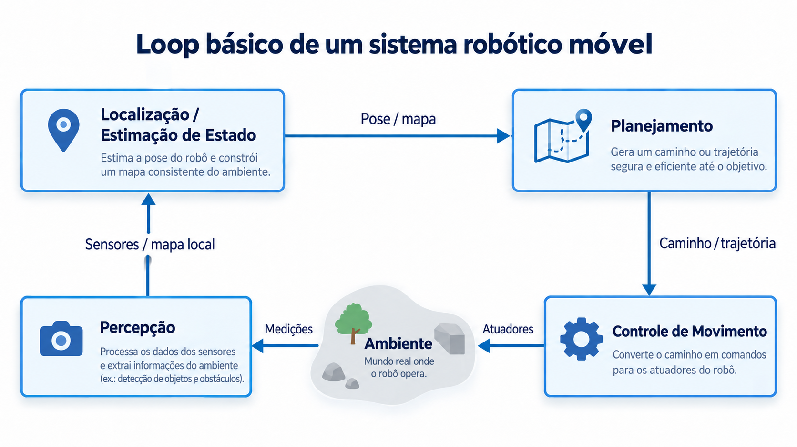

# Robótica Móvel

Projeto didático em Python para o estudo de robôs móveis com rodas utilizando Webots e ROS 2.

## Arquitetura geral

O projeto segue o loop básico de um sistema robótico móvel:



## Objetivos

Nesta etapa, o projeto aborda:

- modelagem cinemática de robôs móveis;
- odometria;
- controle proporcional;
- diferentes configurações de robôs com rodas;
- simulação no Webots;
- comunicação entre nós ROS 2;
- integração entre ROS 2 e Webots;
- execução de trajetórias predefinidas.

## Estrutura

```text
src/robotica/
└── robos/

webots/
├── worlds/
└── controllers/

ros2/
```

- `src/robotica/robos/`: modelos cinemáticos dos robôs móveis;
- `webots/worlds/`: ambientes de simulação;
- `webots/controllers/`: controladores dos robôs simulados;
- `ros2/`: nós ROS 2 para comunicação e movimentação dos robôs.

## Integração ROS 2 e Webots

A integração permite controlar um robô móvel diferencial simulado
no Webots por meio de comandos de velocidade publicados no ROS 2.

A comunicação utiliza:

- Publisher: nó responsável pelo envio dos comandos de velocidade;
- Tópico: `/cmd_vel`;
- Tipo de mensagem: `geometry_msgs/msg/Twist`;
- Subscriber: controlador do Webots responsável pelo recebimento
  dos comandos e acionamento dos motores por meio da cinemática
  inversa.

## Tecnologias

- Python 3
- Webots
- ROS 2
- rclpy (ROS Client Library for Python)
- Programação orientada a objetos
